# System Architecture — Office Attendance Management System

## 1. Architectural Overview

The **Office Attendance Management System** is designed as a **Modular Monolith** backend built with Python / Django REST Framework and a modern **Single Page Application (SPA)** frontend built with React, Vite, TypeScript, and Tailwind CSS.

```mermaid
graph TD
    subgraph Client [Client Tier - Web & Mobile Browser]
        ReactSPA["React 18 + TypeScript SPA<br/>(Tailwind CSS, TanStack Query, React Hook Form)"]
    end

    subgraph Edge [Edge & Ingress Tier]
        ReverseProxy["Reverse Proxy / Cloud Edge<br/>(Render / NGINX / Cloudflare)"]
    end

    subgraph Backend [Backend Tier - Django Modular Monolith]
        APIGateway["Django REST Framework API Gateway<br/>/api/v1/"]
        
        subgraph Services [Domain Services]
            AuthService["Authentication & Session Service"]
            NetVerifyService["Network Verification Service<br/>(IP/CIDR, Proxy Aware, Fail-Closed)"]
            AttendanceService["Attendance Calculation Engine<br/>(Atomic, Idempotent, Shift-Aware)"]
            ShiftService["Shift & Schedule Management Service"]
            LeaveService["Leave Management Service"]
            ReportService["Reporting & Analytics Engine"]
            AuditService["Audit Logging & Compliance Service"]
        end

        subgraph CoreApps [Django Apps]
            AppAccounts["apps.accounts (Custom User)"]
            AppOffices["apps.offices (Offices & Policies)"]
            AppEmployees["apps.employees (Profiles)"]
            AppShifts["apps.shifts (Schedules & Assignments)"]
            AppAttendance["apps.attendance (Records & Attempts)"]
            AppLeaves["apps.leaves (Requests & Balances)"]
            AppReports["apps.reports (Aggregations)"]
            AppAudit["apps.audit (Change Logs)"]
        end
    end

    subgraph Storage [Persistence & Cache Tier]
        PostgreSQL[("PostgreSQL 17 Database<br/>(ACID Transactions, Constraints, Indexes)")]
    end

    ReactSPA -->|HTTPS + HttpOnly Session Cookies + CSRF| ReverseProxy
    ReverseProxy -->|Validated Source IP / Forwarded Headers| APIGateway
    APIGateway --> Services
    Services --> CoreApps
    CoreApps --> PostgreSQL
```

---

## 2. Layered Architecture Principles

1. **Presentation Layer (Frontend)**:
   - Built with React, TypeScript, and Tailwind CSS.
   - TanStack Query handles server state caching, background polling, and optimistic updates.
   - Clean separation of UI components (`components/ui`), feature domains (`features/*`), and API clients (`services/*`).
   - Strict typing with TypeScript interfaces matching backend DTOs/serializers.

2. **API & Presentation Layer (Backend)**:
   - Versioned REST API endpoints (`/api/v1/*`).
   - Strict input validation using Django REST Framework Serializers.
   - Role-Based Access Control (RBAC) via custom permissions (`IsSuperAdmin`, `IsHROrAdmin`, `IsEmployeeSelfOrAdmin`).

3. **Domain Service Layer**:
   - Business rules live in dedicated service classes (`NetworkVerificationService`, `AttendanceEngine`, etc.), not inside views or controllers.
   - High cohesion and testability through pure Python business logic.

4. **Persistence Layer**:
   - Django ORM mapping to PostgreSQL.
   - Relational integrity with Foreign Keys, `ON_DELETE` protections, compound unique constraints, and database indexes on high-frequency search fields (`employee_id`, `attendance_date`, `status`).
   - Concurrency control using `select_for_update()` and atomic transactions for check-in/check-out.

---

## 3. Network Verification Pipeline

Office IP Verification is decoupled from attendance operations:
1. When an employee triggers eligibility check or check-in, the request passes through the **Edge Proxy**.
2. `NetworkVerificationService.get_client_ip(request)` resolves the untampered source IP using strict proxy chain rules.
3. The office's configured `NetworkPolicy` is evaluated:
   - `STRICT_IP_ALLOWLIST`: Matches candidate IP/CIDR (e.g., `223.236.99.39/32`).
   - `ADMIN_MANUAL_REVIEW`: Records check-in as `PENDING_REVIEW` if out of network.
   - `DEVELOPMENT_MOCK`: Enabled only in `DEBUG=True` local environments.
4. An immutable audit record is saved in `AttendanceAttempt` capturing the observed IP, verification result, and reason code.
5. In strict mode, mismatched IPs return HTTP 403 Forbidden with clear diagnostic reason codes.

---

## 4. User Roles & Permission Matrix

| Resource / Capability | Super Admin | HR / Admin | Employee |
| :--- | :---: | :---: | :---: |
| Authenticate (Login/Logout/Me) | Yes | Yes | Yes |
| View Personal Dashboard & History | Yes | Yes | Yes |
| Perform Self Check-In / Check-Out | Yes | Yes | Yes |
| Submit Leave Application | Yes | Yes | Yes |
| View All Employees | Yes | Yes | Read-Only (Directory) |
| Manage Employees (Create/Update/Deactivate) | Yes | Yes | No |
| Configure Departments | Yes | Yes | No |
| Configure Shifts & Assignments | Yes | Yes | No |
| Review & Approve Leaves | Yes | Yes | No |
| View All Attendance Records | Yes | Yes | No |
| Perform Manual Attendance Correction | Yes | Permitted (with Reason) | No |
| Configure Office Network Policies | Yes | No | No |
| Manage Offices & Timezones | Yes | No | No |
| View System Audit Logs | Yes | No | No |
| Export Attendance Reports (CSV/Excel) | Yes | Yes | No |
