# Database Schema Specification

## 1. Entity Relationship (ER) Diagram

```mermaid
erDiagram
    User ||--o| EmployeeProfile : "has"
    Department ||--o{ EmployeeProfile : "belongs to"
    Office ||--o{ EmployeeProfile : "assigned to"
    Office ||--|| NetworkPolicy : "secures"
    Office ||--o{ AttendanceSession : "hosts"
    Office ||--o{ Holiday : "observes"
    
    Shift ||--o{ EmployeeShiftAssignment : "assigned via"
    EmployeeProfile ||--o{ EmployeeShiftAssignment : "receives"
    
    EmployeeProfile ||--o{ AttendanceRecord : "logs"
    AttendanceSession ||--o{ AttendanceRecord : "aggregates"
    
    EmployeeProfile ||--o{ AttendanceAttempt : "traces"
    Office ||--o{ AttendanceAttempt : "context for"
    
    EmployeeProfile ||--o{ LeaveRequest : "applies for"
    User ||--o{ LeaveRequest : "reviews"
    
    User ||--o{ AuditLog : "initiates"

    User {
        uuid id PK
        varchar email UK
        varchar password
        varchar role "SUPER_ADMIN | HR_ADMIN | EMPLOYEE"
        boolean is_active
        datetime date_joined
        datetime last_login
    }

    EmployeeProfile {
        uuid id PK
        uuid user_id FK,UK
        varchar employee_code UK
        varchar first_name
        varchar last_name
        varchar phone
        uuid department_id FK
        uuid office_id FK
        varchar designation
        date joining_date
        varchar employment_status "ACTIVE | PROBATION | SUSPENDED | RESIGNED"
        datetime created_at
        datetime updated_at
    }

    Department {
        uuid id PK
        varchar name UK
        text description
        boolean is_active
        datetime created_at
    }

    Office {
        uuid id PK
        varchar name UK
        varchar timezone "e.g. Asia/Kolkata"
        text address
        boolean is_active
        datetime created_at
    }

    NetworkPolicy {
        uuid id PK
        uuid office_id FK,UK
        varchar verification_mode "STRICT_IP_ALLOWLIST | MANAGED_NETWORK | DEVELOPMENT_MOCK | ADMIN_MANUAL_REVIEW"
        jsonb allowed_ip_ranges "Array of IP/CIDR e.g. ['223.236.99.39/32']"
        boolean strict_mode_enabled
        boolean is_active
        datetime created_at
        datetime updated_at
    }

    Shift {
        uuid id PK
        varchar name UK
        time start_time
        time end_time
        int grace_minutes
        int minimum_work_minutes
        jsonb weekly_off_days "[0, 6]"
        boolean is_overnight
        boolean is_active
        datetime created_at
    }

    EmployeeShiftAssignment {
        uuid id PK
        uuid employee_id FK
        uuid shift_id FK
        date effective_from
        date effective_to "nullable"
        boolean is_active
    }

    AttendanceSession {
        uuid id PK
        uuid office_id FK
        date attendance_date
        datetime opens_at
        datetime closes_at
        varchar status "OPEN | CLOSED"
    }

    AttendanceRecord {
        uuid id PK
        uuid employee_id FK
        uuid session_id FK "nullable"
        date attendance_date
        datetime check_in_at
        datetime check_out_at "nullable"
        varchar attendance_status "PRESENT | LATE | ABSENT | HALF_DAY | ON_LEAVE | HOLIDAY | WEEKLY_OFF | PENDING_REVIEW | MANUALLY_ADJUSTED"
        int working_minutes
        varchar verification_method
        varchar verification_result
        varchar check_in_ip
        varchar check_out_ip
        boolean is_manual_correction
        datetime created_at
        datetime updated_at
    }

    AttendanceAttempt {
        uuid id PK
        uuid employee_id FK
        uuid office_id FK
        datetime attempted_at
        varchar action "CHECK_IN | CHECK_OUT | ELIGIBILITY"
        varchar observed_ip
        varchar verification_result "ALLOWED | REJECTED | PENDING"
        varchar reason_code "IP_MATCHED | IP_MISMATCH | OUTSIDE_WINDOW | NOT_CONFIGURED"
    }

    LeaveRequest {
        uuid id PK
        uuid employee_id FK
        varchar leave_type "CASUAL | SICK | PAID | UNPAID"
        date start_date
        date end_date
        text reason
        varchar status "PENDING | APPROVED | REJECTED | CANCELLED"
        uuid reviewed_by FK "nullable"
        text review_notes
        datetime reviewed_at
        datetime created_at
    }

    Holiday {
        uuid id PK
        uuid office_id FK "nullable"
        varchar name
        date date
        boolean is_recurring
    }

    AuditLog {
        uuid id PK
        uuid actor_id FK "nullable"
        varchar action
        varchar entity_type
        varchar entity_id
        jsonb old_values
        jsonb new_values
        text reason
        varchar ip_address
        datetime created_at
    }
```

---

## 2. Relational Constraints & Database Indexes

### Unique Constraints
- `User(email)`: Guaranteed unique login.
- `EmployeeProfile(employee_code)`: Unique human-readable employee identifier (e.g., `EMP-1001`).
- `EmployeeProfile(user_id)`: 1-to-1 relationship between `User` and `EmployeeProfile`.
- `AttendanceRecord(employee_id, attendance_date)`: Ensures at most one official attendance record exists per employee per date.
- `NetworkPolicy(office_id)`: 1-to-1 active policy per office.

### High-Performance Indexes
- `AttendanceRecord(employee_id, attendance_date)`: For lightning-fast profile lookups and history filtering.
- `AttendanceRecord(attendance_date, attendance_status)`: For admin daily KPI aggregation.
- `AttendanceAttempt(employee_id, attempted_at)`: For real-time throttling and audit analysis.
- `LeaveRequest(employee_id, status, start_date)`: For pending leave checks and calendar queries.
- `AuditLog(entity_type, entity_id, created_at)`: For entity change auditing.
